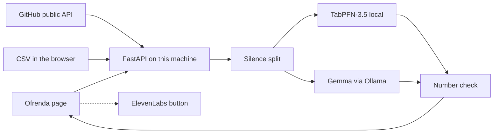

# El Eco

An algorithmic ofrenda for the ghosts of unfinished work.

You give it a public GitHub repository, or a CSV that never has to leave your machine, or the fictional sample ghost bundled with this repo. It finds the week the work went quiet. [TabPFN-3.5](https://github.com/PriorLabs/tabpfn), running locally, says what the later weeks would have held if the last rhythm had continued. [Gemma](https://ai.google.dev/gemma), through [Ollama](https://ollama.com), may then speak as that project. A fact check throws the speech away if it cites a number that is not in the record.

This altar is for abandoned projects. It is not a memorial for a person, and it will not invent one.

## Why the open pieces are the product

A closed chat API could write a spooky paragraph. It would also be the thing the project depends on: the history leaves the machine, the bill starts when the candle is lit, and the séance dies if that vendor changes the model or the price.

El Eco is arranged the other way around.

- **The forecast is TabPFN-3.5 on this computer.** The silent weeks are not in the training table. Each of them is described with a month, a week of the year, and the commit lags frozen at the last living weeks, so the question stays inside the range of the life the model actually saw. Weights download once, after you accept Prior Labs' non-commercial license, and the table is not sent to Prior Labs when you run the local package.
- **The voice is Gemma, also local, and optional.** If Ollama is down, or Gemma writes a number that is not on the altar, the page speaks from the record instead of pretending. You can point `OLLAMA_MODEL` at another Gemma tag. A non-Gemma override is refused rather than mislabeled.
- **A CSV séance does not need the network at all**, once the weights are on disk and Ollama is running. The file is read in the browser and posted only to the El Eco process on this machine.
- **GitHub is read through its public API**, for repositories the world can already see. There is no headless browser walking a profile in the background.

ElevenLabs is a separate button. Pressing it sends the eulogy text off the machine, and the page says so. The rite itself does not.

## Run it

Python 3.12 is the version to use. TabPFN's PyTorch wheels are happier there than on 3.14.

```bash
py -3.12 -m venv .venv
.venv\Scripts\activate
pip install -r requirements-dev.txt
uvicorn el_eco.main:app --host 127.0.0.1 --port 8000
```

Open http://127.0.0.1:8000 and choose **Set a place for lumen-notes**. That path fetches nothing.

Before the forecast candle will light:

1. Accept the TabPFN-3.5 non-commercial license at [platform.priorlabs.ai](https://platform.priorlabs.ai).
2. Put the token in `.env` as `TABPFN_TOKEN` (see `.env.example`). The server will not open a browser for you. The account page the installed package uses is [ux.priorlabs.ai](https://ux.priorlabs.ai).
3. The first real forecast downloads the weights. After that, the model runs offline.

Before Gemma will speak:

```bash
ollama pull gemma3
```

`OLLAMA_HOST` defaults to `http://127.0.0.1:11434`.

```bash
pytest
```

## What the forecast is, and is not

It is not a claim that the repository would have become popular. Stars are not predicted. Lines of code are not invented.

It is a seasonal continuation. TabPFN-3.5 is fit only on weeks before the final silence. A week counts as the death of the work when the last commit is at least 90 days ago. The graveyard list uses 120 days, so a short rest does not get a tombstone. Future rows reuse the lag values from the end of the life, and vary only by month and week of year. The magenta line on the altar is that expectation. The number in the eulogy is the sum of it, rounded, and the fact check will not let any other integer through.

The first time you call TabPFN it can take a while on CPU. The dev server should be one process, not a reloader that imports the weights twice.

## Docker and Render

```bash
docker compose up --build
```

The app is published on `127.0.0.1:8000`. Compose points `OLLAMA_HOST` at `host.docker.internal:11434` so a Gemma that is already running on the host can answer. The image installs TabPFN, so it is large, and a small machine can run out of memory while the model sits in RAM. Render's blueprint is `render.yaml`: a Docker web service on the starter plan, with `healthCheckPath: /api/health`. Set `TABPFN_TOKEN` and, if you want the séance there too, an `OLLAMA_HOST` the service can reach. Do not put a real token in the blueprint file.

## Prize categories this project actually uses

Entered, because the code calls them:

- **Best Use of TabPFN.** Local TabPFN-3.5 regressor, inside the ritual, on the weekly table.
- **Best Use of Gemma.** Local Gemma through Ollama, with a number check against the dossier.
- **Best Use of Render.** `render.yaml` plus the Dockerfile, as the runtime for the altar and the forecast.
- **Best Use of ElevenLabs.** Optional, only after the button that discloses the network call. Set `ELEVENLABS_API_KEY`.
- **Best Use of Browserbase.** For a public repository, a Browserbase browser opens the GitHub page and brings the README words back. Commit counts still come from the GitHub API.

Not entered:

- Anything else in the Week 4 list. Unused partner tech is not listed in the write-up.

One submission can qualify for several categories. It can win once. The Week 4 FAQ on the [challenge page](https://dev.to/challenges/hacktoberfest-week4-2026-10-26) says so.

## How a request moves



The dashed line is the only step that sends the eulogy away, and only if you ask.

A public repository can also be opened in a Browserbase browser. That read uses `BROWSERBASE_API_KEY`. The words come back with the digits stripped, and Gemma still has to speak from the numbers TabPFN and the commit table already produced. The sample ghost and a CSV never open a browser.

## Layout

- `el_eco/sources.py` reads the sample life, a CSV, or public commits.
- `el_eco/series.py` bins weeks and finds the trailing silence.
- `el_eco/forecast.py` builds the in-range table and calls TabPFN-3.5.
- `el_eco/speech.py` asks Gemma, then rejects a eulogy that cites a stray integer.
- `el_eco/voice.py` calls ElevenLabs when the button is pressed.
- `static/` is the candlelit page.

## License

MIT for this repository. TabPFN-3.5 weights are under Prior Labs' non-commercial license, which is separate, and you accept that yourself before the weights download.
