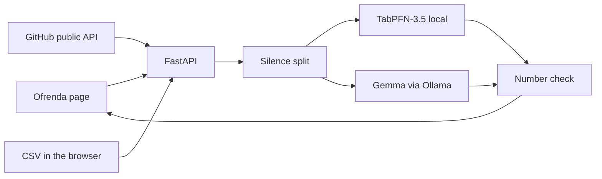

*This is a submission for the [Hacktoberfest Open-Source AI Challenge: Week 4](https://dev.to/challenges/hacktoberfest-week4-2026-10-26), Ghost in the Machine.*

## What I built

El Eco is an algorithmic ofrenda for unfinished work. Not for a person. For the repository you stopped pushing, or a CSV of a habit you stopped logging.

You set a public GitHub repo on the altar, or a file that stays on your machine, or the fictional sample ghost `lumen-notes`. The page finds the week the work went quiet. TabPFN-3.5, running locally, draws the weeks after that as a continuation of the last rhythm: same season, same lag, no invented stars and no invented lines of code. Gemma, through Ollama, may then speak in the first person as that project. If it cites a number that is not in the dossier, the speech is thrown out and the altar reads the record instead.

The page is a dark chapel. Three candles, the dates, a chart with the lived line in bone and the unwritten line in magenta, then the eulogy.

## Demo

Local: `uvicorn el_eco.main:app` and open the sample ghost. It fetches nothing.

Repository: https://github.com/REPLACE_WITH_YOUR_REPO

The sample life is a local markdown journal, born 6 June 2022, last touched in early 2023, then years of zeros. TabPFN never sees those zeros while it fits. It only sees the living weeks.

## How it works



A week is the death of the work when the last commit is at least 90 days behind today. Training rows stop there. Each silent week is a row of month, ISO week, and the lag-1, lag-2, and lag-4 commit counts frozen at the end of the life. Those features stay inside the range TabPFN saw, which is the honest way to ask a tabular model about a counterfactual instead of extrapolating a week-index off the edge of the table.

Gemma gets a dossier and a list of allowed integers. The server checks the reply. The grounded fallback is there so a missing model does not become a made-up future.

ElevenLabs is a second button, labeled as a network call. The rite does not press it for you.

## Why open innovation matters here

A closed model could write the paragraph. It could not do the thing the altar is for.

The interesting input is a personal history: a dead repo, or a spreadsheet of a habit. Posted to a chat API, that history becomes someone else's log. With TabPFN and Gemma on the machine, a CSV séance needs no network once the weights are local. The GitHub path only asks GitHub for a repository the world can already open.

Open weights also keep the séance editable. Swap the Ollama tag, and the ghost changes voice without a new vendor. Refuse a non-Gemma override, which this project does, and you do not accidentally enter a Gemma category with a different model. The fact check is possible because the forecast is a table of numbers we computed, not a vibe from a hosted agent we cannot inspect.

It also costs nothing per candle. The first TabPFN download and the Gemma weights are the whole bill.

## Where the open path was the better one

Commit dates still come from GitHub's public API. For a public repository, a Browserbase browser also opens the page and brings back what the repository says about itself. Those words have their digits stripped before Gemma sees them, so a number on the webpage cannot sneak into the eulogy.

I also did not ask a hosted LLM to "estimate how big the project would be now." That number would have been a costume. TabPFN's sum is a specific expectation under a stated assumption, the last rhythm held, and the eulogy is not allowed to improve on it.

## Prize categories

- Best Use of TabPFN
- Best Use of Gemma
- Best Use of ElevenLabs, when the key is set and the button that says the text is leaving the machine is pressed
- Best Use of Browserbase, for a public repository: a remote browser opens the GitHub page and the words come back to the local séance

One submission can qualify for more than one category. It can win once.

## Agent session

The session is private on DEV until it is published. Embed it with:

```liquid

```
